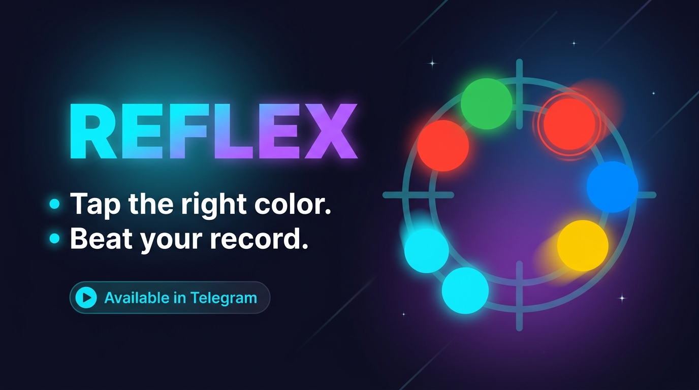

  

<h1 align="center">REFLEX</h1>

  Аркада на одну минуту. 
  Цвет сверху меняется. Круги не ждут. Ошибаться дорого.

  <b>Блиц · 60 секунд</b> &nbsp;·&nbsp; <b>Выживание · 3 жизни</b> &nbsp;·&nbsp; <b>Telegram Mini App</b>

---

## Как играть

Сверху горит цель: цвет и знак. На поле всплывают круги. Попадание в цель даёт очки и растит комбо. Чужой цвет и пропущенная цель наказывают.

Чем дольше держится серия, тем выше множитель: x2, x3, x5. Поле ускоряется, цветов становится больше, круги начинают двигаться.

## Два режима

| | Блиц | Выживание |
|---|---|---|
| Ставка | 60 секунд | 3 жизни |
| Ошибка | −3 секунды | −1 жизнь |
| Пропуск цели | −2 секунды | −1 жизнь |
| Рекорд | очки | время |
| Награда | монеты за очки | монеты за очки |

В блице нужно выжать максимум, пока тикает таймер. В выживании нужно продержаться: рекорд пишется в секундах, очки всё равно превращаются в монеты.

## Зачем возвращаться

- **Задание дня.** Каждый день новая цель и отдельная награда.
- **Магазин.** Монеты тратятся на бустеры и палитры. Фриз останавливает поле, магнит подсвечивает нужный цвет, дополнительные секунды и жизнь выручают в своём режиме.
- **Достижения.** Серии, чистый блиц, уровни и копилка. Каждое открывается один раз и платит монетами.
- **Рекорды.** Лучшие забеги блица и выживания хранятся на устройстве.
- **Разбор раунда.** После игры видны точность, комбо, уровень и число ошибок.

Игра сделана под телефон: крупные цели, знаки внутри кругов, вибрация, звук попадания и пауза в один тап.

---

Один экран. Два режима. Никакой пощады к медленным пальцам.

